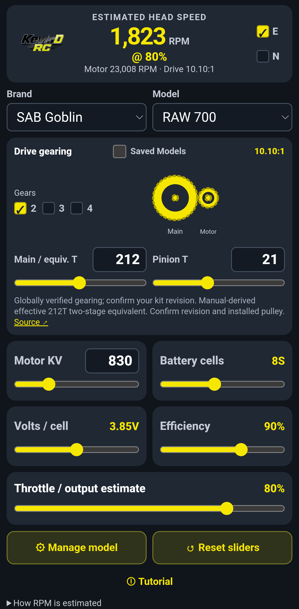
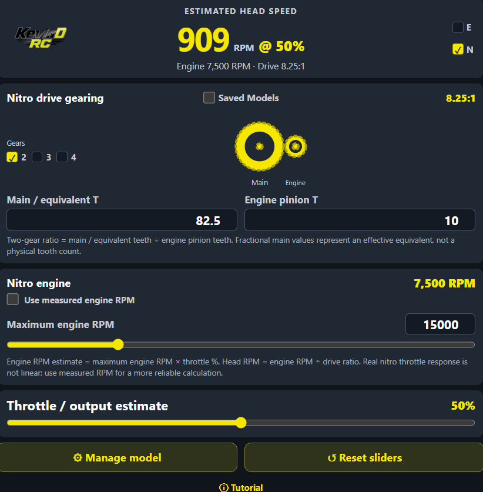

# 🚁 KevinD RC RPM Calculator

**Calculate. Configure. Fine-Tune. Fly.**

A free, installable **electric and nitro RC helicopter head-speed calculator** with multi-gear drivetrain support, verified gearing, model management, and an interactive tutorial.

[🚀 **Launch the Calculator**](https://harrykd33.github.io/KevinD-RC-RPM-Calculator/) · [⚙️ **Manage Models**](https://harrykd33.github.io/KevinD-RC-RPM-Calculator/gearing.html) · [💬 **Report an Issue**](https://github.com/Harrykd33/KevinD-RC-RPM-Calculator/issues)

## 📸 Screenshots

The screenshot gallery below is ready for genuine captures of the running app. Screenshots have **not yet been uploaded**; add the corresponding images under `docs/screenshots/`.

| Electric calculator | Nitro calculator |
| --- | --- |
| `docs/screenshots/electric-calculator.png` | `docs/screenshots/nitro-calculator.png` |

| Model selection | Manage Models | Tutorial |
| --- | --- | --- |
| `docs/screenshots/model-selection.png` | `docs/screenshots/manage-models.png` | `docs/screenshots/tutorial.png` |

After uploading the images, replace the filename tables above with these image references:

```md




```

## ⚡ Electric Helicopter Calculator

- Estimate main rotor RPM using **motor KV, battery voltage, gearing, throttle, and efficiency**.
- Select **2S–16S** battery configurations and adjust volts per cell.
- Explore nominal, full-charge, and under-load voltage assumptions.
- Adjust motor KV, throttle, and efficiency using numeric inputs or sliders.
- Review the estimated motor RPM and drivetrain ratio.
- Visual RPM color feedback provides guidance, not guaranteed safe limits.

## ⛽ Nitro Helicopter Calculator

- Switch between **Electric (E)** and **Nitro (N)** modes.
- Calculate rotor speed from engine RPM and transmission reduction.
- Configure **2-gear, 3-gear idler, or 4-gear compound** drivetrains with diagrams.
- Estimate running engine speed from maximum RPM and throttle percentage, or enter **measured engine RPM**.
- Save and load personal nitro gearing models locally.

> Actual nitro throttle response is not linear. Measured engine RPM is preferable when available.

## ⚙️ Helicopter Models and Gearing

- Model selection across **Goosky, SAB Goblin, XLPower, OMP Hobby, Tron, Mikado, Align, Soxos, MSH, Synergy, Gaui, and KDS**.
- Source-backed gearing presets for models in the published verified catalogue.
- Manual gearing and effective main-gear-equivalent entries for multi-stage transmissions.
- **Direct-drive (1:1)** configuration support.
- Clear distinction between verified gearing and models still awaiting verification.

## 🗂️ Manage Models

- Browse unverified models and filter by manufacturer.
- Add or edit locally saved gearing specifications.
- Create personal offline custom models.
- Export/import JSON backups for use on another device.
- Prepare updates to `verified-gearing.json` for global publication through GitHub.

### How global verification works

1. Confirm installed gearing against a trustworthy manual or manufacturer source.
2. Enter the model, ratio or tooth counts, and supporting source in **Manage Models**.
3. Select **Prepare catalogue update** and review the downloaded `verified-gearing.json`.
4. Commit the reviewed file to the published GitHub branch.
5. Online users can load the updated catalogue; verified models are excluded from the unverified list.

**Personal models are device-local**; exporting and importing JSON is necessary to transfer them. The management PIN is a UI gate, **not secure authentication**; GitHub write permissions protect the global database.

## 🎓 Interactive Guided Tutorial

A first-run walkthrough spotlights the relevant controls and explains RPM calculations, gear ratios, voltage, efficiency, and governor headroom. Electric and Nitro modes each have their own guide; select **Tutorial** to run it again.

## 📱 Installable and Offline Ready

This project is a **Progressive Web App (PWA)** with app icons and service-worker caching. In a supported browser, open the calculator and select **Install app** or **Add to Home Screen**. Offline use is available after the app is successfully cached.

## 🚀 Quick Start

1. [Open the live app](https://harrykd33.github.io/KevinD-RC-RPM-Calculator/).
2. Select **Electric** or **Nitro**.
3. Choose a verified model, a saved personal model, or custom gearing.
4. Enter your motor/battery or engine RPM and gearing information.
5. Compare the calculated head-speed estimate and adjust the setup as needed.
6. Confirm drivetrain specifications, operating limits, and actual RPM before flying.

## 📁 Project Files

| File | Purpose |
| --- | --- |
| `index.html` | Main calculator UI |
| `gearing.html` | Model management and catalogue publishing workflow |
| `model-catalog.js` | Built-in model catalogue and verified gearing loader |
| `verified-gearing.json` | Shared published verified gearing |
| `nitro.js` | Nitro RPM and transmission calculations |
| `tutorial.js` | Guided walkthrough |
| `manifest.webmanifest` | PWA installation metadata |
| `sw.js` | Offline asset cache |

## 🤝 Community Feedback

Missing a helicopter model or found a gearing error? [Open a GitHub Issue](https://github.com/Harrykd33/KevinD-RC-RPM-Calculator/issues) with the model, gear specifications, kit revision, and supporting manufacturer documentation.

## ⚠️ Disclaimer

These RPM values are **estimates**, not live tachometer measurements. Battery voltage under load, governor behavior, drivetrain losses, flight conditions, and installed parts can affect actual head speed. Check manufacturer limits and verify RPM before flight.

---

**Built by an RC helicopter pilot, for RC helicopter pilots.**  
**KevinD RC — See you at the field!**
